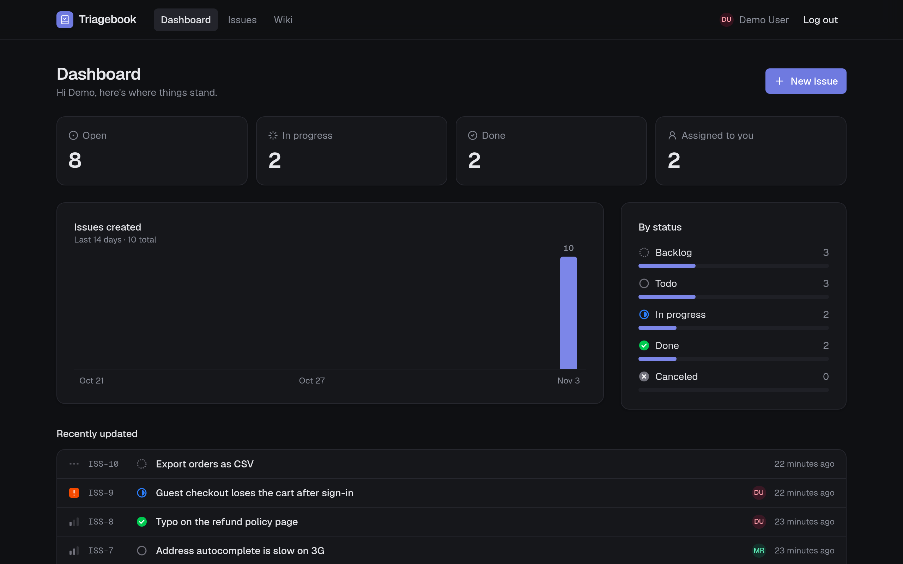
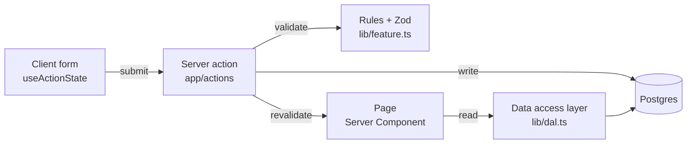

# Triagebook

[](https://github.com/aishwaryr/triagebook/actions/workflows/ci.yml)

An issue tracker and a team wiki in one app. Triage the work, and keep the docs next to the issues they explain.

**Live demo:** https://triagebook.vercel.app
Click **Try Demo** on the sign-in page, no account needed. (Or sign in with `demo@triagebook.dev` / `triagebook-demo`.)



## Features

- **Dashboard:** open, in-progress, done and assigned-to-you counts, a 14-day "issues created" chart, issues by status, and recently updated issues.
- **Issues:** create, edit, delete, and assign to any teammate (or yourself in one click). Each issue has a readable key and URL, like `/issues/ISS-12`.
- **Filters in the URL:** status and priority filters live in the query string, so a filtered list can be bookmarked and shared.
- **Comments:** a timeline on every issue, with author and date.
- **Wiki:** markdown pages with tables, code and lists, at readable URLs like `/wiki/release-process`.
- **Issues ↔ wiki links:** an issue lists the pages that explain it, and a page lists its issues.
- **Auth:** email and password sign-up and sign-in, with every app page behind a session check.

## Tech stack

| Area | Choice |
|---|---|
| Framework | Next.js 16 (App Router), React 19: Server Components and Server Actions |
| Language | TypeScript |
| UI | Tailwind CSS v4, shadcn/ui (Radix), Lucide icons, Geist |
| Data | Neon Postgres, Drizzle ORM, Drizzle Kit migrations |
| Validation | Zod |
| Testing | Playwright end-to-end tests, one spec per feature, run against a production build in GitHub Actions |
| Hosting | Vercel, in the same region as the database |

## Architecture

Every feature is built in the same six layers, bottom up:



- **Reads:** pages are async Server Components. They read through one server-only data access layer, where every query checks the session first.
- **Writes:** forms post to Server Actions. Each action checks the user, validates with Zod, writes, revalidates the affected pages and redirects. Field errors come back to the form without losing what the user typed.
- **Schema:** one Drizzle schema is the source of the database tables and the TypeScript row types.

## Engineering notes

- **Sessions:** a random 256-bit token in an `HttpOnly`, `Secure`, `SameSite=Lax` cookie. The database stores only its SHA-256 hash, so a leaked table can't be used to sign in.
- **Passwords:** bcrypt, with the 72-byte limit checked in bytes, not characters.
- **Readable keys:** a Postgres identity column gives each issue its `ISS-n` number. The UUID stays the primary key, so URLs and foreign keys stay independent.
- **Data integrity:** foreign keys choose between cascade (comments and links go with their issue) and set null (a deleted user's pages and comments stay, and their issues become unassigned). A unique constraint is the final guard against duplicate emails.
- **Safe markdown:** wiki pages render without raw HTML, and `javascript:` links are stripped.
- **No chart library:** the dashboard chart is plain markup and CSS.
- **Tests against production builds:** Playwright builds the app and runs it with `next start` for every run.

## Roadmap

- **AI features:** turn a pasted Slack thread or email into issue drafts to review; priority suggestions with a reason; related issues and pages through Postgres full-text search; and answers from the wiki with citations.
- **Mobile layout** across the app, and an accessibility pass over all forms.
- **Text search and an assignee filter** on the issues list, and rate limiting on sign-in.

## Run locally

1. Copy `.env.example` to `.env.local` and set `DATABASE_URL` to a Postgres connection string (Neon works).
2. Install, run the migrations, and start the dev server:

```bash
npm install
npm run db:migrate
npm run dev
```

Open http://localhost:3000. Node 24 is pinned in `.nvmrc`.

## Tests

```bash
npm run lint
npm run pw:run                                 # all end-to-end tests
npx playwright test tests/e2e/signin.spec.ts   # one feature
```

Specs live in `tests/e2e/`, one per feature. Playwright builds the app and serves it on port 3100, so the dev server on port 3000 can keep running. `tests/e2e/global-setup.ts` seeds the test accounts before each run.

GitHub Actions (`.github/workflows/ci.yml`) runs lint and the full Playwright suite on every pull request and every push to `master`, against a Neon branch kept for CI. It needs a `DATABASE_URL` repository secret.
